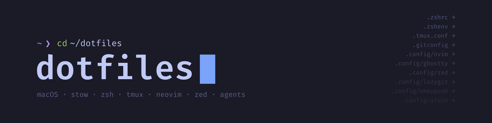
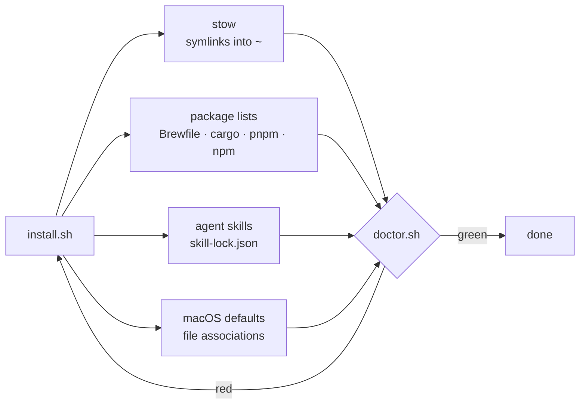
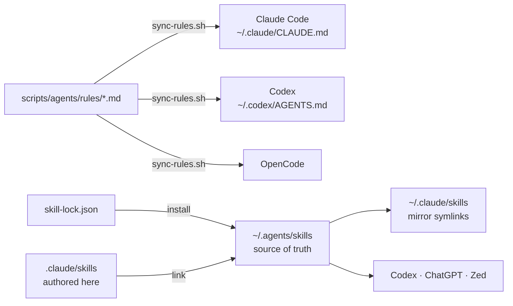

# dotfiles



My macOS setup: shell, terminal, editors and the config for the AI agents I work with. One `install.sh` takes a fresh Mac to this state, and `doctor.sh` checks that it got there.


## Quick start

```sh
git clone https://github.com/magnusrodseth/dotfiles.git ~/dotfiles
cd ~/dotfiles
bash install.sh        # idempotent, safe to re-run
bash scripts/doctor.sh # read-only ✓/✗ checklist
```

The repo must live at `~/dotfiles`, because `stow` links relative to its parent directory. `install.sh` installs Homebrew and `stow` if they are missing.

## How it works



Config files are symlinked with `stow`. Packages are not: each package manager has a list with `export` and `install` commands, so a new machine restores from the lists. A step that fails does not stop the run. `install.sh` reports every failure at the end and exits non-zero.

## Agent setup

Several agents read instructions and skills from different places. This repo keeps one source for each and copies it to the rest.



## Tools

| Tool | Role |
|---|---|
| [Ghostty](https://ghostty.org) | Terminal (Tokyo Night, FiraCode Nerd Font) |
| [tmux](https://github.com/tmux/tmux) + [tpm](https://github.com/tmux-plugins/tpm) | Terminal multiplexer (Catppuccin Mocha) |
| [zsh](https://www.zsh.org) + [zinit](https://github.com/zdharma-continuum/zinit) | Shell and plugin manager |
| [oh-my-posh](https://ohmyposh.dev) | Prompt |
| [atuin](https://atuin.sh) | Shell history, synced across machines |
| [fzf](https://github.com/junegunn/fzf), [zoxide](https://github.com/ajeetdsouza/zoxide), [eza](https://github.com/eza-community/eza), [bat](https://github.com/sharkdp/bat) | Fuzzy finding, `cd`, `ls`, file viewing |
| [Zed](https://zed.dev) | Main editor and `$EDITOR` |
| [Neovim](https://neovim.io) + [LazyVim](https://www.lazyvim.org) | Terminal editor |
| [VS Code](https://code.visualstudio.com) | Secondary editor |
| [lazygit](https://github.com/jesseduffield/lazygit) + [delta](https://github.com/dandavison/delta) | Git TUI and diff pager |
| [Claude Code](https://www.anthropic.com/claude-code), [Codex](https://github.com/openai/codex), [OpenCode](https://opencode.ai), [pi](https://github.com/earendil-works/pi) | Coding agents |
| [T3 Code](https://t3.codes) | Agent workspace |
| [OrbStack](https://orbstack.dev) | Containers and Linux VMs |
| [Raycast](https://www.raycast.com) | Launcher and window management |
| [Brave](https://brave.com) | Browser |
| [1Password](https://1password.com) | Secrets, also for scripts via `op` |

## More

[`CLAUDE.md`](CLAUDE.md) is the full runbook: every install step, the stow rules, the security watch, and why things are set up the way they are.
